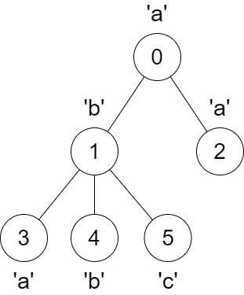
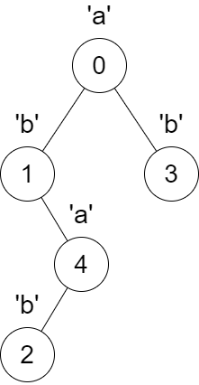

<h3>Find Subtree Sizes After Changes</h3>

You are given a tree rooted at node 0 that consists of <code>n</code> nodes numbered from <code>0</code> to <code>n - 1</code>. The tree is represented by an array <code>parent</code> of size <code>n</code>, where <code>parent[i]</code> is the parent of node <code>i</code>. Since node 0 is the root, <code>parent[0] == -1</code>.

You are also given a string <code>s</code> of length <code>n</code>, where <code>s[i]</code> is the character assigned to node <code>i</code>.

We make the following changes on the tree <strong>one</strong> time <strong>simultaneously</strong> for all nodes <code>x</code> from <code>1</code> to <code>n - 1</code>:

<ul>
<li>Find the <strong>closest</strong> node <code>y</code> to node <code>x</code> such that <code>y</code> is an ancestor of <code>x</code>, and <code>s[x] == s[y]</code>.</li>
<li>If node <code>y</code> does not exist, do nothing.</li>
<li>Otherwise, <strong>remove</strong> the edge between <code>x</code> and its current parent and make node <code>y</code> the new parent of <code>x</code> by adding an edge between them.</li>
</ul>

Return an array <code>answer</code> of size <code>n</code> where <code>answer[i]</code> is the <strong>size</strong> of the <button aria-controls="radix-_r_u_" aria-expanded="false" aria-haspopup="dialog" class="" data-state="closed" type="button">subtree</button> rooted at node <code>i</code> in the <strong>final</strong> tree.

 

<button aria-pressed="true" class="h-5 max-w-[10rem] truncate whitespace-nowrap rounded-sd-sm border px-2 text-xs font-normal leading-none border-sd-border bg-sd-background text-sd-foreground" type="button">Original</button><button aria-pressed="false" class="h-5 max-w-[10rem] truncate whitespace-nowrap rounded-sd-sm border px-2 text-xs font-normal leading-none border-transparent text-sd-muted-foreground hover:text-sd-foreground" type="button">Python3</button><strong>Example 1:</strong>

<strong>Input:</strong> parent = [-1,0,0,1,1,1], s = "abaabc"

<strong>Output:</strong> [6,3,1,1,1,1]

<strong>Explanation:</strong>

The parent of node 3 will change from node 1 to node 0.

<strong>Example 2:</strong>

<strong>Input:</strong> parent = [-1,0,4,0,1], s = "abbba"

<strong>Output:</strong> [5,2,1,1,1]

<strong>Explanation:</strong>

The following changes will happen at the same time:

<ul>
<li>The parent of node 4 will change from node 1 to node 0.</li>
<li>The parent of node 2 will change from node 4 to node 1.</li>
</ul>

 

<strong>Constraints:</strong>

<ul>
<li><code>n == parent.length == s.length</code></li>
<li><code>1 &lt;= n &lt;= 105</code></li>
<li><code>0 &lt;= parent[i] &lt;= n - 1</code> for all <code>i &gt;= 1</code>.</li>
<li><code>parent[0] == -1</code></li>
<li><code>parent</code> represents a valid tree.</li>
<li><code>s</code> consists only of lowercase English letters.</li>
</ul>

